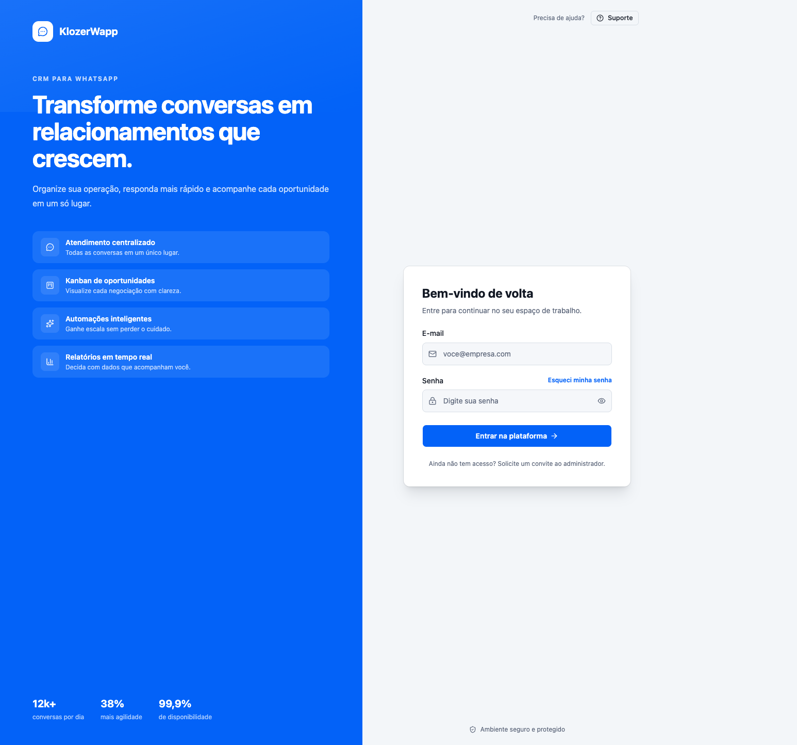

# Klozer Wapp

### CRM open source para atendimento, vendas e relacionamento pelo WhatsApp

Centralize conversas, organize sua operação comercial e acompanhe cada
atendimento em um único produto.

**[Funcionalidades](#funcionalidades)** · **[Prévia](#prévia)** ·
**[Contribuição](#contribuição)**

---

## Sobre o projeto

O **Klozer Wapp** é um CRM open source focado em operações que usam o
WhatsApp como principal canal de atendimento. Ele reúne a comunicação com
clientes e as rotinas da equipe em um só lugar, com uma API em Go e uma
interface web moderna em React.

O projeto foi criado para ajudar equipes a:

- 💬 atender clientes com histórico e contexto;
- 🗂️ distribuir conversas entre filas e responsáveis;
- 📌 acompanhar oportunidades e atendimentos em um quadro Kanban;
- ⚡ automatizar respostas e fluxos de atendimento;
- 📣 executar campanhas e acompanhar resultados;
- 📊 transformar a operação em indicadores para tomada de decisão.

## Funcionalidades

| Módulo | O que você pode fazer |
|---|---|
| 💬 **Conversas** | Consultar histórico, enviar mensagens e acompanhar interações. |
| 📱 **WhatsApp** | Conectar uma sessão por QR Code, monitorar o status e receber mensagens em tempo real. |
| 👥 **Contatos** | Organizar contatos, telefones, tags e informações do relacionamento. |
| 🗂️ **Filas** | Separar atendimentos por equipe, setor ou tipo de operação. |
| 📌 **Kanban** | Visualizar e mover cards para acompanhar o andamento dos atendimentos. |
| ⚡ **Respostas rápidas** | Criar mensagens prontas para agilizar o trabalho da equipe. |
| 🤖 **Automações** | Criar fluxos e processar mensagens recebidas conforme regras do negócio. |
| 📣 **Campanhas** | Criar e executar campanhas a partir da própria plataforma. |
| 📞 **Chamadas** | Registrar e consultar o histórico de chamadas por telefone. |
| 📊 **Relatórios** | Acompanhar métricas e a evolução da operação em um dashboard. |
| 🔐 **Acesso seguro** | Autenticação JWT e permissões por perfil de usuário. |

## Prévia

### Tela de acesso

### Identidade visual

Os arquivos de identidade visual estão disponíveis em [`screen/`](screen/):

- [`logo.svg`](screen/logo.svg), para uso em interfaces e materiais vetoriais;
- [`image.png`](screen/image.png), para uso em materiais com fundo escuro.

## Contribuição

Contribuições são bem-vindas! Para propor uma melhoria:

1. faça um fork do projeto;
2. crie uma branch para sua alteração;
3. implemente e teste a mudança;
4. abra um pull request descrevendo o contexto e a solução.

Issues, sugestões de funcionalidades, correções e melhorias na documentação
também são bem-vindas.

## Roadmap

O Klozer está em evolução. Algumas frentes planejadas incluem:

- envio e gerenciamento de mídias;
- evolução das automações e campanhas;
- indicadores mais completos para vendas e atendimento;
- experiência multiempresa e novas integrações;
- documentação da API e testes automatizados mais abrangentes;
- execução simplificada com Docker;
- script de instalação e configuração para VPS.

## Licença

Distribuído sob a [Licença MIT](LICENSE). Consulte o arquivo para conhecer
as permissões e condições de uso, cópia, modificação e distribuição.

---

Feito para construir atendimentos melhores, com código aberto e colaboração.

Criado por **[Jefferson Challes](https://jefferson.dev)** ·
[Site](https://jefferson.dev) ·
[GitHub](https://github.com/Jeffersoncharlles)

